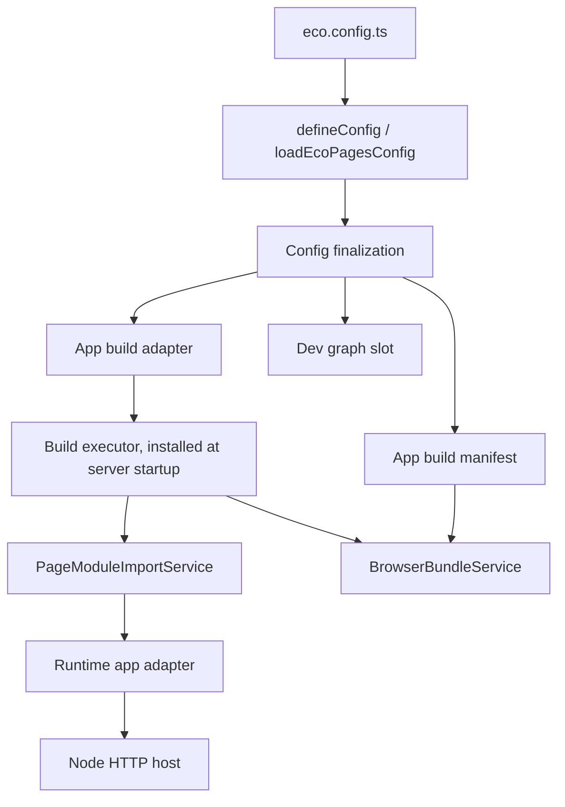
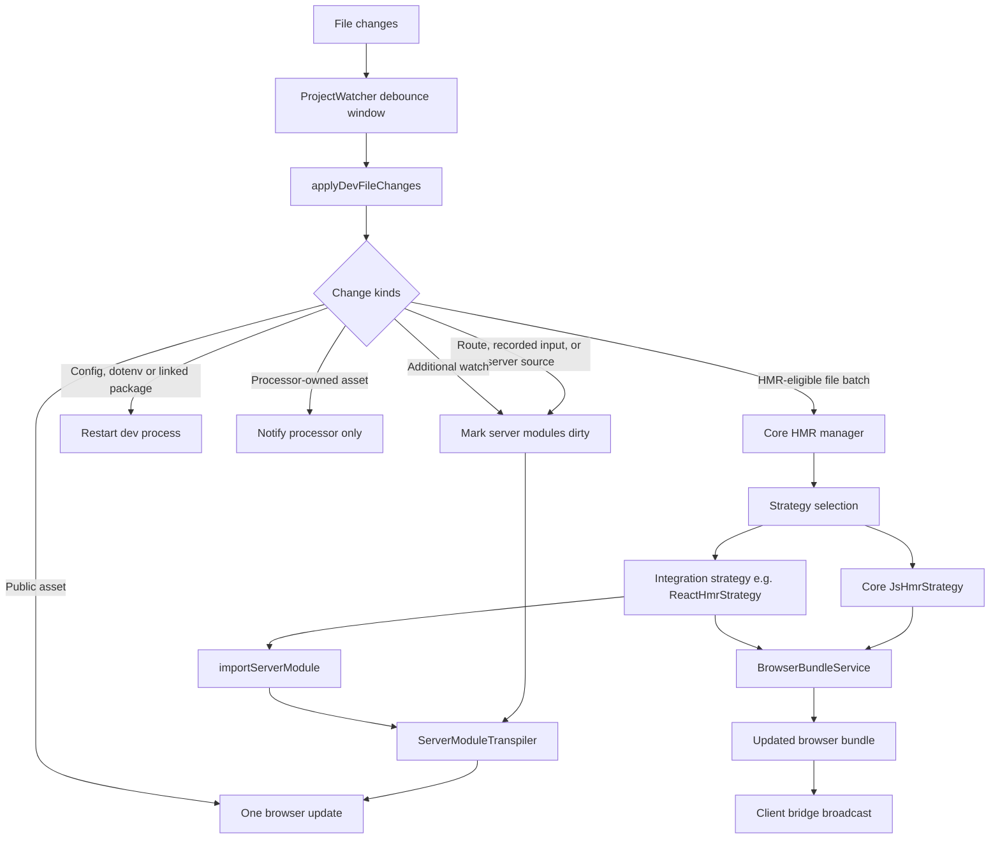

# @ecopages/core

The foundational engine for the Ecopages framework. It provides the core build pipeline, development server, routing, and plugin architecture required to run an Ecopages application.

## Overview

Ecopages is an extensible static site generator (SSG). It runs on Node or Bun through Node APIs. It embraces a strictly MPA (Multi-Page Application) architecture by default, rendering HTML at build-time or request-time, and hydrating interactive islands only where necessary.

- **Runtime Boundary**: `createApp()` uses the Node HTTP host. The start log names Bun or Node from the process that launched it.
- **Build Ownership**: Rolldown builds the app.
- **Framework agnostic**: First-class support for KitaJS, Lit, React, and MDX via official integration plugins.
- **Extensible**: Hook into the build process with custom processors or rendering integrations.

## Current Architecture

Projects load shared ambient types through `@ecopages/core/declarations`. This entry references `src/css-imports.d.ts`, which keeps the wildcard CSS declaration in a standalone ambient file so side-effect CSS imports typecheck without per-project declarations.

The current core package is organized around app-owned runtime state and explicit service boundaries.

The important ownership rules are:

- Config finalization, when `createApp()` loads `eco.config.ts`, installs the app-owned build adapter, build manifest, and runtime state; server startup adds the build executors.
- Build requests declare server or browser environment independently of scheduling. Integrations and Processors contribute one environment-selected plugin list; config rejects duplicate names within an environment. Core source transforms preserve source locations and the bridge composes chained maps. See [Build Layer](src/build/README.md) and [Plugin Contracts](src/plugins/README.md) for migration.
- Component identity attribution is one shared source transform for server, browser, and HMR compilation paths: after a lexical `eco.` gate, it uses Oxc to wrap supported factory options with `bindComponentIdentity()`, which factories retain as `config.identity`.
- Direct local Eco Component imports (including named `export { X } from` barrels) and relative side-effect CSS imports supply Dependencies by default through the shared transform and existing collector; explicit asset declarations override inference, and inferred styles stay keyed by identity until collection. See [eco](src/eco/README.md) and [Plugin Contracts](src/plugins/README.md).
- Every renderer receives the app-owned `AssetProcessingService`; dependency collection uses it to turn declared assets into runtime-ready output instead of treating a missing service as an empty asset set. See [Route Renderer](src/route-renderer/README.md).
- Browser bundling and server module loading are separate paths. SSR-enabled lazy scripts execute on the server before rendering and in the browser only on their configured trigger.
- The Project Watcher batches file and directory events, sends matching Processors one `onChanges` notification for each non-restart file batch, and dispatches every HMR-eligible path once per debounce window. Directory-only Pages batches refresh routes without Processor or HMR notifications. Sustained edits are scheduled no later than one second after the first; processing is serialized and startup fails if the filesystem subscription is not ready within 30 seconds. See [Project Watcher](src/watchers/README.md).
- Development Page prewarm path collection and rendering run in the background without delaying server readiness. App configuration declares `devPrewarmPaths`; Processors declare pathnames through `collectDevPrewarmPaths()`. Collection failures are logged with their stack. See [Runtime Adapters](src/adapters/README.md) and [Plugin Contracts](src/plugins/README.md).
- App shutdown tears down Integration runtime resources, including Lit workers. See [Runtime Adapters](src/adapters/README.md).
- HMR and invalidation use shared graph-aware services instead of runtime-specific ad hoc wiring.
- Browser and React navigation use one core-owned document commit pipeline; each router supplies its page swap and scroll handling while core coordinates fetch/cache/parse, head reconciliation, script activation, view transitions, and lifecycle events. Browser-router always morphs the incoming body, keeping nodes with matching persistence keys attached when their ancestor structure remains compatible; during rerun refresh, custom-element descendants on that path also stay in place when their markup remains structurally compatible. Superseded stylesheet waits settle when a later page removes their staged links. For rerun scripts matched by relative `src` (without an explicit script id or HTML `id`), core keeps identity stable across pages with different `<base>` URLs while loading external modules from the incoming page's resolved URL. See [Router Layer](src/router/README.md).
- The build adapter returns each build's plugin-recorded inputs by module alongside source-module closures, and passes an explicit recorder to Rolldown plugin hooks. Cache owners bind only the paths read by their entry closure, so development invalidates affected Page Browser Graphs, HTML entries, route modules, and browser entrypoints. Grouped browser scripts resolve by the path or name the caller passed (and the bundler's facade when that spelling differs); in-process Page caches also track reachable generated artifacts. See [Build Layer](src/build/README.md).

### Bootstrap And Runtime Ownership



### Development Invalidation And HMR Flow



The manager/orchestration layer is core-owned, but framework-specific strategies such as React HMR are contributed by integrations and registered with the shared HMR manager.

### Practical Summary

- Config finalization seeds one app-owned build ownership path, build adapter, build manifest, and a no-op dev graph that development replaces; server startup installs the build executors.
- `BrowserBundleService` is the shared browser build seam used by HMR and asset-oriented browser output paths.
- `ServerModuleTranspiler` is the shared server-side source loading seam used by runtime bootstrap and HMR metadata loading.
- `RouteRegistry` gives exact and dynamic Pages priority over catch-alls, then selects the most specific matching catch-all prefix.
- Browser runtime package entries resolve from the application root with ESM import conditions, so framework-local packages cannot shadow app dependencies.
- `createApp()` stays the universal runtime entrypoint and uses the Node HTTP host. The start log names the process that launched it.
- One bundled adapter builds the app with Rolldown.

## Documentation Map

Use this package README as the top-level map, then drill into the focused subsystem READMEs:

- `src/config/README.md`: config finalization and app-owned runtime/build state
- `src/plugins/README.md`: integration and processor authoring contracts
- `src/build/README.md`: build adapter, executor, shared `.server` browser import guard, development build coordination, standalone Node server packaging and its deploy layout
- `src/services/README.md`: cross-cutting runtime services and orchestration helpers
- `src/adapters/README.md`: Node HTTP host and shared adapter boundaries
- `src/dev/README.md`: dev transform server, on-demand client delivery (including workspace-package `@fs` URLs), and invalidation during compilation
- `src/watchers/README.md`: recursive source subscriptions with bounded readiness and scheduled debounce batches, external build-input and linked-package watching, batched `applyDevFileChanges`, and restart invalidation
- `src/services/invalidation/README.md`: file-change classification and dirty-marking for bounded watcher batches
- `src/hmr/README.md`: HMR strategy, update-layer ownership, and build error presentation
- `src/dev-toolbar/README.md`: toolbar enablement, custom clients, and build error event contract
- `src/router/README.md`: route discovery, matching, browser navigation coordination, persistence-aware body morphing, and the shared client navigation pipeline
- `src/route-renderer/README.md`: rendering orchestration, dependency resolution, and HTML cache source paths
- `src/static-site-generator/README.md`: static build execution path
- `src/eco/README.md`: `eco` authoring APIs for pages, layouts, and components, including the `LayoutOptions` type contract
- `src/html-pages/README.md`: built-in `.html` Filesystem Routes, Html shell, and head reconciliation

The intended reading order is:

1. this file for the big-picture architecture
2. `src/config/README.md` for config and lifecycle ownership
3. `src/plugins/README.md` and `src/build/README.md` for contribution contracts
4. `src/services/README.md` and `src/adapters/README.md` for runtime execution
5. `src/router/README.md` and `src/route-renderer/README.md` for request-time flow

## Installation

```bash
bun add @ecopages/core
```

_(You can also use `npm`, `yarn`, or `pnpm`)_

## Basic Usage

The Ecopages architecture revolves around an `eco.config.ts` file and an application entry point.

### 1. Configuration (`eco.config.ts`)

Configure your integrations, processors, and default metadata:

```typescript
import { defineConfig } from '@ecopages/core/config';
import { ecopagesJsxPlugin } from '@ecopages/ecopages-jsx';

export default defineConfig({
	rootDir: import.meta.dirname,
	baseUrl: process.env.ECOPAGES_BASE_URL ?? 'http://localhost:3000',
	defaultMetadata: {
		title: 'My Ecopages Site',
		description: 'Built with Ecopages',
	},
	integrations: [ecopagesJsxPlugin()],
});
```

### 2. Application Entry (`app.ts`)

Start the application using `createApp`. It automatically resolves and loads `eco.config.ts` from the project root and serves through the Node HTTP host on Node and on Bun:

```typescript
import { createApp } from '@ecopages/core/create-app';

const app = await createApp();

await app.start();
```

### 3. Creating Pages

Use the `eco.page()` factory to define static routes. Place these in `src/pages/`:

```tsx
import { eco } from '@ecopages/core';
import { BaseLayout } from '@/layouts/base-layout';

export default eco.page({
	layout: BaseLayout,
	metadata: () => ({
		title: 'Home',
	}),
	render: () => (
		<div>
			<h1>Welcome to Ecopages</h1>
		</div>
	),
});
```

Plain `.html` files in `src/pages/` are HTML Pages and need no Integration: `src/pages/about.html` becomes `/about`, rendered inside `src/includes/html.*` or a built-in HTML template. See [HTML Pages](https://ecopages.app/docs/core/pages#html-pages).

### 4. Reusable Components

Define components with `eco.component()` to automatically inject necessary stylesheets or scripts only when that component is rendered:

```tsx
import { eco } from '@ecopages/core';

export const MyButton = eco.component({
	dependencies: {
		stylesheets: ['./button.css'],
	},
	render: ({ label }) => <button className="my-button">{label}</button>,
});
```

Dependency ownership affects final asset packaging:

- Stylesheets and scripts declared from `eco.html()` stay Html-owned and can be emitted as shared app-wide assets.
- Stylesheets and scripts declared from Pages, Layouts, or Components are resolved into page-owned assets for the rendered route.
- This split is intentional. Shared Html assets can be cached across routes, while page-owned assets can change without invalidating the global shell.

### 5. API Handlers

Add server-side routes using `defineApiHandler` or the method helpers (`defineGet`, `definePost`, …). Register them on your `app` instance before starting:

```typescript
import { defineApiHandler, defineGet, json } from '@ecopages/core';

export const helloWorld = defineGet({
	path: '/api/hello',
	handler: async ({ response }) => {
		return response.json({ message: 'Hello World' });
	},
});

// Equivalent with an explicit method:
export const helloWorldAlt = defineApiHandler({
	path: '/api/hello',
	method: 'GET',
	handler: async () => json({ message: 'Hello World' }),
});
```

Group related routes with `defineGroupHandler`. Prefer `api.get` / `api.post` helpers inside the `routes` callback:

```typescript
import { defineGroupHandler } from '@ecopages/core';

export const adminGroup = defineGroupHandler({
	prefix: '/admin',
	routes: (api) => [
		api.get({
			path: '/',
			handler: async ({ response }) => response.json({ ok: true }),
		}),
		api.post({
			path: '/items',
			handler: async ({ response }) => response.status(201).json({ created: true }),
		}),
	],
});
```

Standalone response helpers (`json`, `html`, `redirect`) share the same body emission path as `context.response.json()` / `context.response.html()`.

Register a prebuilt handler with `app.add()`. Use `app.get(path, handler)` only when defining the route inline in `app.ts`.

### 6. Error pages

Filesystem `src/pages/404.*` and `500.*` take precedence. For explicit-route apps, register views on the app:

```typescript
app.notFound('./src/views/not-found.kita');
app.serverError('./src/views/server-error.kita');
```

String and URL view paths passed to `app.static()`, `app.notFound()`, and `app.serverError()` load through the server-module transpiler. Raw dynamic `import()` skips component-identity transforms. A full explicit view renders through the same route pipeline as a filesystem Page, including its layouts, default metadata, robots meta, and page client plan. Props passed to the render are available to the view's `metadata`.

When no custom page is configured, built-in HTML defaults are served instead.

Attach the handler in your `app.ts` entry:

```typescript
import { createApp } from '@ecopages/core/create-app';
import { helloWorld } from './handlers/hello';

const app = await createApp();

app.add(helloWorld);

await app.start();
```

See the [official documentation](https://ecopages.app) for advanced usage, API handlers, and integrations.

## Import Structure

Use the `create-app` subpath for runtime startup and the root package for standard authoring helpers:

```ts
import { createApp } from '@ecopages/core/create-app';
import { defineApiHandler, defineGet, defineGroupHandler, eco } from '@ecopages/core';
```

> [!NOTE]
> Use `createApp()` from `@ecopages/core/create-app` as the application entrypoint.

## Entry Point Roles

The published subpaths are grouped by architectural role rather than by source folder.

### App Authoring

Use these entrypoints when building an Ecopages app:

- `@ecopages/core`
- `@ecopages/core/create-app`
- `@ecopages/core/config`
- `@ecopages/core/errors`
- `@ecopages/core/hash`
- `@ecopages/core/declarations`
- `@ecopages/core/env`

### Browser Navigation

Use these entrypoints when a browser runtime needs to coordinate document ownership and link intent:

- `@ecopages/core/router/navigation-coordinator`
- `@ecopages/core/router/navigation-pipeline`
- `@ecopages/core/router/navigation-lifecycle`
- `@ecopages/core/router/link-intent`

### Extension Authoring

Use these entrypoints when implementing integrations, processors, or source transforms:

- `@ecopages/core/plugins/integration-plugin`
- `@ecopages/core/plugins/processor`
- `@ecopages/core/plugins/source-transform`
- `@ecopages/core/build/contracts/server-only-specifier` (dependency-free naming predicate, safe for browser imports)
- `@ecopages/core/route-renderer/orchestration/integration-renderer`
- `@ecopages/core/route-renderer/orchestration/document-shell/layout-shell-props.service`
- `@ecopages/core/services/asset-processing-service`
- `@ecopages/core/assets/hashed-browser-asset`
- `@ecopages/core/hmr/hmr-strategy`

### Build Adapter

Use this entrypoint when an app needs the framework build adapter:

- `@ecopages/core/build/build-adapter`

App code and most extensions should prefer the app-authoring or extension-authoring surfaces.
