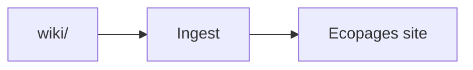
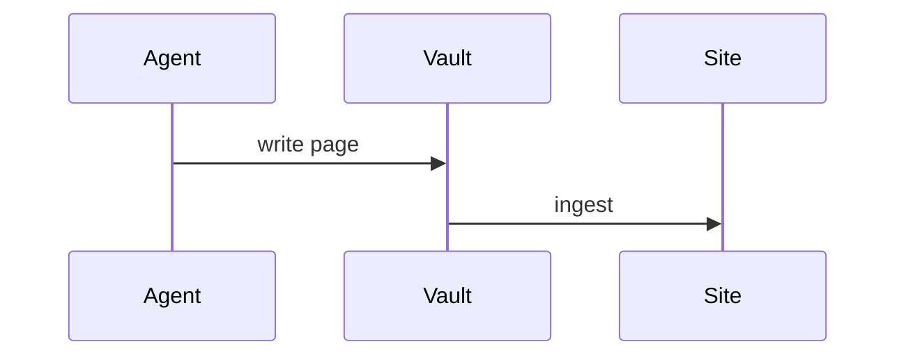

# This is a demo page

This is a demo page showing the capabilities of the LLM wiki template.

## Linking

### Same category

Link to another page in the same directory: [another entry](./another-entry.md).

### Cross-category

Link to a page in a different directory: [wiki structure](../concept/wiki-structure.md).

The link rewriter resolves these to `/wiki/concept/wiki-structure`.

## Diagrams

A `mermaid` code block renders as an inline SVG at build time.

